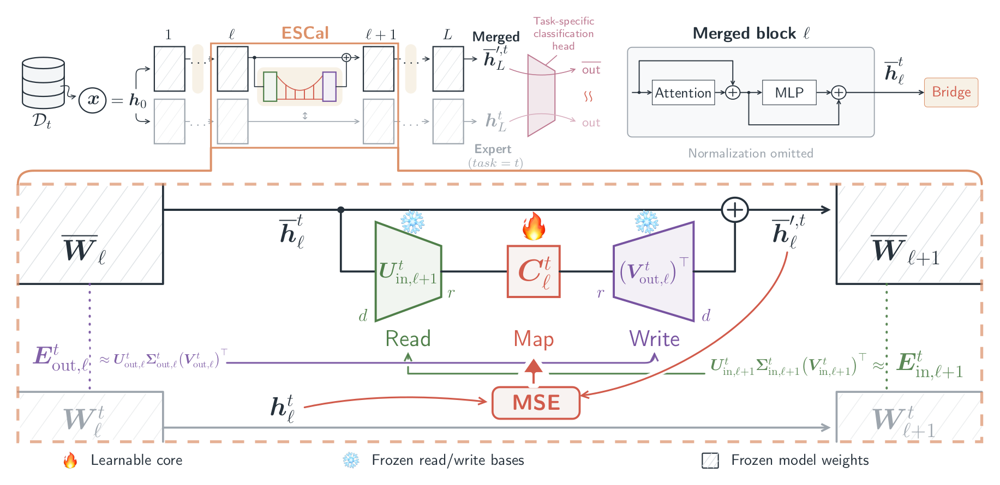

<!-- markdownlint-disable MD033 -->

## Main Figure

<object data="/assets/img/escal/escal-figure1.pdf" width="100%" height="40%" type='application/pdf'></object>

## Abstract

Model merging combines task-specific expert models into a single model without joint training on their original datasets, but often incurs a performance gap relative to the individual experts. Post-merging calibration can reduce this gap through task-specific representation alignment, but the alignment objective alone does not specify which feature directions to correct. We propose **E**rror-**S**ubspace **Cal**ibration (ESCal), a post-merging calibration framework that identifies low-dimensional error subspaces from weight differences between expert and merged models. At each intermediate block boundary, a Bridge module projects the merged representation onto the next block’s input-projection error subspace and maps these coordinates to an additive correction in the current block’s output-projection error subspace. The subspace bases remain fixed, so calibration learns only these linear maps, yielding a parameter-efficient mechanism for feature correction. We find that ESCal brings the merged model closer to the experts in both representations and predictions, indicating more faithful recovery of task-specific behavior. Experiments on vision and natural language understanding benchmarks show that ESCal improves merged-model performance across diverse architectures and merging methods using a small calibration set for each task.

## Read the Full Paper

<object data="{{ page.pdf }}" width="960" height="1000" type='application/pdf'></object>
